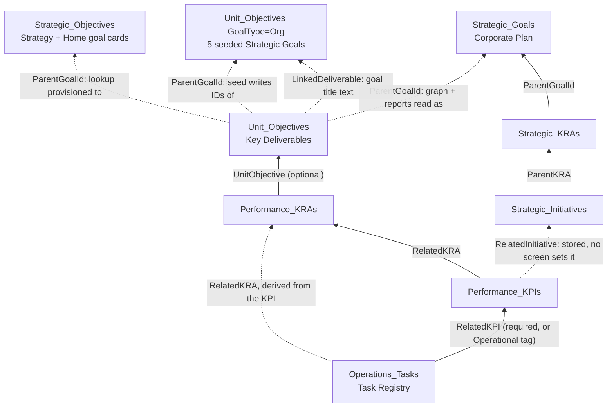

# Task Registry to Organisational Goals: Connection Audit

Audit date: 11 November 2026. Branch `fix/division-scoped-figures` at `30cd841`, including uncommitted working-tree changes.

This audit re-checks the [7 September audit](2026-09-07-task-to-goal-audit.md) (findings F01–F22) against the current code, after the September remediation (phases 1–4, PRs #2–#6 and `3ba5342`). It adds new findings N01–N08. It reads code only. No SharePoint records were read or changed.

## Summary

The lower half of the chain is now sound. A task's KRA is derived from its KPI, writes check versions, every list read in the chain is paginated, parents can't be deleted while children exist, manual KPIs keep their mode, and new tasks must pick a KPI or be marked Operational. The strategy test suite passes (210/210, `node scripts/run-strategy-tests.mjs`).

The top hop is still broken: Unit Objective to organisational goal. There are three different "goal" lists. The one field that links an objective to a goal (`ParentGoalId`) is written with IDs from one list, provisioned to look up a second list, and read as IDs of a third, depending on the page. As a result:

- The Strategy page goal cards, Home goal cards, Strategy hierarchy and the frozen reports can give different answers for the same goal.
- None of them can be trusted to show which tasks feed which organisational goal.

Progress is also calculated by three separate engines with different rules, so the same KRA can show different percentages on different screens.

Last measured data quality, from the Linkage tab on 29 September (Corporate Services only): 2 of 56 tasks were fully traced (4%). Even "traced" stops at the Unit Objective. It does not prove that a task reaches an organisational goal (N02).

## How the chain is connected today

Solid arrows are lookups that the application writes and validates. Dotted arrows are optional, text-only, or read inconsistently.

| Hop | Stored as | Enforced? | Evidence |
|---|---|---|---|
| Task → KPI | `RelatedKPILookupId` | New tasks: KPI or `strategy:operational` tag, enforced in the form only | [TaskDialog.tsx:357](../../src/components/unit-tabs/TaskDialog.tsx:357), [taskAlignment.ts:66](../../src/utils/taskAlignment.ts:66) |
| Task → KRA | `RelatedKRALookupId` | Derived from the KPI on create/update. A conflicting KRA is rejected. A KPI move realigns its tasks. | [sharePointOpsService.ts:753](../../src/services/sharePointOpsService.ts:753), [:906](../../src/services/sharePointOpsService.ts:906), [:1526](../../src/services/sharePointOpsService.ts:1526) |
| KPI → KRA | `RelatedKRALookupId` | Always set by the combined KRA/KPI form | [sharePointOpsService.ts:1442](../../src/services/sharePointOpsService.ts:1442) |
| KRA → Unit Objective | `UnitObjectiveLookupId` | Optional; no validation in the KRA form | [sharePointOpsService.ts:1306](../../src/services/sharePointOpsService.ts:1306) |
| Unit Objective → goal | `ParentGoalIdLookupId` plus `LinkedDeliverable` text | Not validated; read three ways (N01) | [sharePointListSetupService.ts:513](../../src/services/sharePointListSetupService.ts:513), [kraKpiSeedService.ts:333](../../src/services/kraKpiSeedService.ts:333) |
| KPI → Strategic Initiative | `RelatedInitiativeLookupId` | Persisted and read since September, but no component sets `initiative_id` | [sharePointOpsService.ts:1443](../../src/services/sharePointOpsService.ts:1443), [:1973](../../src/services/sharePointOpsService.ts:1973) |
| Task → Project | `RelatedProjectLookupId` | Not used. Board columns write `RelatedTaskGroupLookupId`. Projects have no KRA/KPI link. | [sharePointOpsService.ts:865](../../src/services/sharePointOpsService.ts:865), [:2047](../../src/services/sharePointOpsService.ts:2047) |

Who reads the chain, and with which engine:

| Screen | Goal source | Progress engine |
|---|---|---|
| `/strategy` goal cards | `Strategic_Objectives`, plus Corporate Plan track blended in | `kpiUtils` (live, weighted when weights exist) |
| Home → Organisational overview | `Strategic_Objectives`, no Corporate Plan track | `kpiUtils` |
| `/strategy` division hierarchy | `LinkedDeliverable` title, then `ParentGoalId` | `kpiUtils` for %; stored KRA progress for status (N05) |
| `/unit` and `/division` reports (frozen snapshots) | `ParentGoalId` read as a `Strategic_Goals` ID | Strategy execution graph (child average) |
| Stored `Progress` columns on KRA/Objective | none | Service sync (% of KPIs with Completed status) |
| `/division` Linkage tab | stops at Unit Objective | none (counts links) |
| `/division` overview/analytics metrics | none | `useDivisionMetrics` (F16) |

## Status of the September findings

"Verified" means re-checked in the current code for this audit. "Per remediation docs" means the September phase notes and their passing tests say it was fixed, but this audit did not re-trace it line by line.

| ID | Finding (Sept) | Status now | Basis |
|---|---|---|---|
| F01 | Goal IDs mixed across separate lists | **Open, wider.** Reports now use a third reading (N01). | Verified: [Strategy.tsx:479](../../src/pages/Strategy.tsx:479), [kpiUtils.ts:133](../../src/utils/kpiUtils.ts:133), [kpiUtils.ts:163](../../src/utils/kpiUtils.ts:163), [strategyExecutionGraphService.ts:606](../../src/services/strategyExecutionGraphService.ts:606) |
| F02 | Initiative branch can't receive KPI links; goal calc exits early | **Partly fixed.** KPI `initiative_id` is now persisted and read, but nothing in the UI sets it. Goal calc still returns 0 when there are no Unit Objectives, and the Corporate track still needs both KRAs and Initiatives present. | Verified: [kpiUtils.ts:130](../../src/utils/kpiUtils.ts:130), [kpiUtils.ts:162](../../src/utils/kpiUtils.ts:162) |
| F03 | Progress means different things per surface | **Open.** Sync = % of KPIs Completed. `kpiUtils` = weighted attainment when weights exist, otherwise % Completed. Graph = average of child progress. A 50/100 manual KPI gives the KRA 0% (stored), 0% or 50% (`kpiUtils`, depending on weights) and 50% (reports). | Verified: [sharePointOpsService.ts:1751](../../src/services/sharePointOpsService.ts:1751), [kpiUtils.ts:72](../../src/utils/kpiUtils.ts:72), [strategyExecutionGraphService.ts:183](../../src/services/strategyExecutionGraphService.ts:183) |
| F04 | Completed/nonzero states survive reopening or removal | **Partly fixed.** Service sync now resets KRA status to Open below 100%, writes 0 for an empty KRA or Objective, and recomputes checklist status. Still open: Strategy and Home replace a computed 0% with the stored value, and `calculateKraProgress` uses stored progress when a KRA has no KPIs. | Verified: [Strategy.tsx:489](../../src/pages/Strategy.tsx:489), [OrganizationalOverview.tsx:49](../../src/components/dashboard/OrganizationalOverview.tsx:49), [kpiUtils.ts:66](../../src/utils/kpiUtils.ts:66) |
| F05 | Linking a task converts a manual KPI to checklist | **Fixed** | Verified: [sharePointOpsService.ts:1600](../../src/services/sharePointOpsService.ts:1600) |
| F06 | Missing pagination in sync and readers | **Fixed for the chain.** `getProjects` still reads one page (outside the chain). | Verified: [sharePointOpsService.ts:368](../../src/services/sharePointOpsService.ts:368), [:722](../../src/services/sharePointOpsService.ts:722) |
| F07 | No integrity contract on delete/move/dual links | **Mostly fixed.** Delete guards on Objective/KRA/KPI. KRA move resyncs both Objectives. Task KRA is derived from its KPI. Remaining gap: N06. | Verified: [sharePointOpsService.ts:611](../../src/services/sharePointOpsService.ts:611), [:1404](../../src/services/sharePointOpsService.ts:1404), [:1557](../../src/services/sharePointOpsService.ts:1557), [:1389](../../src/services/sharePointOpsService.ts:1389) |
| F08 | Saving an active work plan loses IDs / duplicates | **Fixed** | Per remediation docs; `workPlanPreservation` tests pass |
| F09 | Work-plan label and ID can point at different objectives | **Fixed** (strategic reference separated from execution ID) | Per remediation docs; tests pass |
| F10 | Title-only KRA reuse can reparent a KRA | **Fixed** | Per remediation docs |
| F11 | Direct routes skip edit permission | **Fixed** (work-plan access policy, admin-only Test Ground) | Per remediation docs; `workPlanAccessIdentity` tests pass |
| F12 | Full ancestry optional; parents hidden | **Partly fixed.** New tasks must choose KPI or Operational. The KRA → Objective link is still optional. The KPI picker shows names only, with no KRA/goal trail (N03). | Verified: [TaskDialog.tsx:659](../../src/components/unit-tabs/TaskDialog.tsx:659) |
| F13 | Failures look like empty/complete results | **Mostly fixed.** Readers and rollups now rethrow. | Verified: [sharePointOpsService.ts:539](../../src/services/sharePointOpsService.ts:539), [:1721](../../src/services/sharePointOpsService.ts:1721), [useSharePointOps.ts:353](../../src/hooks/useSharePointOps.ts:353) |
| F14 | Division report period/scope ignored | **Fixed** (frozen graph snapshot) | Per remediation docs (Phase 4) |
| F15 | Unit reports not reproducible | **Fixed** (checksum-verified archive) | Per remediation docs; [ReportsTab.tsx:1068](../../src/components/unit-tabs/ReportsTab.tsx:1068) |
| F16 | Division alignment and risk overstate | **Open, unchanged** | Verified: see N07 |
| F17 | Completion dates not real events | **Open.** `completedAt` is still last-modified time. A task created already Done gets no `CompletionDate`. | Verified: [sharePointOpsService.ts:2100](../../src/services/sharePointOpsService.ts:2100), [:770](../../src/services/sharePointOpsService.ts:770) |
| F18 | AI/demo provenance | **Partly fixed.** AI now reads archived evidence. Strategy still falls back to built-in mock objectives when the list is empty. | Verified: [Strategy.tsx:449](../../src/pages/Strategy.tsx:449), [Strategy.tsx:471](../../src/pages/Strategy.tsx:471) |
| F19 | Graph silently drops unlinked tasks / cycles | **Fixed** (exception bucket, diagnostics) | Verified: [strategyExecutionGraphService.ts:1081](../../src/services/strategyExecutionGraphService.ts:1081), [:1348](../../src/services/strategyExecutionGraphService.ts:1348) |
| F20 | Graph not ready as universal engine | **Partly fixed** (measurement evidence). Still used only by reports. | Per remediation docs |
| F21 | Status vocabulary mismatches | **Open (not re-checked against tenant).** KPI form writes `Behind` for anything not on-track/at-risk/completed. Sync writes `In Progress`/`Not Started`. | [sharePointOpsService.ts:1437](../../src/services/sharePointOpsService.ts:1437), [:1680](../../src/services/sharePointOpsService.ts:1680) |
| F22 | No concurrency protection | **Fixed** (ETag `If-Match` plus one recalculation retry) | Verified: [sharePointOpsService.ts:402](../../src/services/sharePointOpsService.ts:402), [:1717](../../src/services/sharePointOpsService.ts:1717) |

Score: 10 fixed, 7 partly fixed, 5 open. None of the open items breaks the task → KPI → KRA link itself. They sit at the objective → goal hop, in the progress calculations, or in dates and status labels.

## New findings

**N01 — P1: The objective → goal link field is read three different ways.**
`Unit_Objectives.ParentGoalId` is provisioned as a lookup to `Strategic_Objectives` ([sharePointListSetupService.ts:513](../../src/services/sharePointListSetupService.ts:513)). The official seed creates the 5 Strategic Goals as `GoalType=Org` rows inside `Unit_Objectives`, then writes those row IDs into `ParentGoalId` on each Key Deliverable ([kraKpiSeedService.ts:298](../../src/services/kraKpiSeedService.ts:298), [:333](../../src/services/kraKpiSeedService.ts:333)). The value is then read in three ways:
- The Strategy and Home goal cards match it against `Strategic_Objectives` IDs ([kpiUtils.ts:133](../../src/utils/kpiUtils.ts:133)).
- The graph behind every frozen report treats it as a `Strategic_Goals` ID ([strategyExecutionGraphService.ts:606](../../src/services/strategyExecutionGraphService.ts:606)), and it only falls back to the title when the field is empty.
- The Strategy hierarchy avoids the field and groups by `LinkedDeliverable` text ([Strategy.tsx:1113](../../src/pages/Strategy.tsx:1113)).

A match in any of these is a coincidence of numbers between unrelated lists. It can attach work to the wrong goal or silently drop it. This is the main reason a task's contribution to an organisational goal can't be shown reliably.

**N02 — P1: "Traced" in the Linkage tab stops one hop short of the goal.**
A task counts as traced when its KPI, that KPI's KRA, and that KRA's Objective all exist ([linkageInventoryService.ts:249](../../src/services/linkageInventoryService.ts:249)). For the Objective → goal hop, the tab only checks that `ParentGoalId` or `LinkedDeliverable` is non-empty, not that it resolves to a goal ([linkageInventoryService.ts:367](../../src/services/linkageInventoryService.ts:367)). The 4% baseline therefore measures Task → Objective, not Task → Organisational Goal. Once N01 is settled, the inventory should resolve the goal and count only full paths.

**N03 — P2: The task KPI picker lists every KPI in the organisation, by name only.**
`getKPIs` ignores its `department` argument ([sharePointOpsService.ts:677](../../src/services/sharePointOpsService.ts:677)), so the Unit page's "unit" KPI query returns the whole organisation ([Unit.tsx:204](../../src/pages/Unit.tsx:204)). Managers and admins see all of it in the task form, with no KRA, unit or goal shown ([TaskDialog.tsx:666](../../src/components/unit-tabs/TaskDialog.tsx:666)). Same-named KPIs in different divisions can't be told apart, so cross-division mislinks are easy. Staff see only KPIs they are personally assigned to ([TaskDialog.tsx:156](../../src/components/unit-tabs/TaskDialog.tsx:156)). An officer with no KPI assignment can only choose "Operational", which pushes real strategic work out of the count.

**N04 — P2: Home and Strategy calculate the same goal differently.**
The Strategy goal cards blend the Corporate Plan track into a goal's progress ([Strategy.tsx:475](../../src/pages/Strategy.tsx:475)). The Home overview calls the same function without it ([OrganizationalOverview.tsx:47](../../src/components/dashboard/OrganizationalOverview.tsx:47)). Whenever any Strategic KRA and Initiative exist, the two pages show different percentages for the same goal.

**N05 — P2: Objective status and objective progress come from different data on the Strategy hierarchy.**
Progress is computed live from KPIs ([Strategy.tsx:351](../../src/pages/Strategy.tsx:351)). Status (`calculateObjectiveStatus`) reads `kra.unitKpis`, which the mapper always sets to `[]` ([sharePointOpsService.ts:1924](../../src/services/sharePointOpsService.ts:1924)), so status falls back to stored KRA progress ([kpiUtils.ts:204](../../src/utils/kpiUtils.ts:204)). An objective can show, for example, 50% with status "Not Started", or 0% with status "Completed".

**N06 — P3: Stored Objective progress still counts retired KRAs.**
`syncObjectiveProgress` averages every KRA linked to the Objective without excluding `IsRetired` ([sharePointOpsService.ts:2695](../../src/services/sharePointOpsService.ts:2695)). The KRA reader hides retired KRAs ([sharePointOpsService.ts:674](../../src/services/sharePointOpsService.ts:674)), so the stored figure is diluted by records nobody can see.

**N07 — P1 (was F16, unchanged): Division metrics overstate alignment and hide risk.**
- "Strategic alignment" = KRAs with a non-empty objective ID ([useDivisionMetrics.ts:49](../../src/hooks/useDivisionMetrics.ts:49)). It does not check the objective or goal exists.
- Every in-progress KPI counts as on-track ([:31](../../src/hooks/useDivisionMetrics.ts:31)).
- Unit comparisons copy the division KPI figure into every unit and use a fixed 75 for project health ([:87](../../src/hooks/useDivisionMetrics.ts:87)).
- KRA-to-unit matching uses substring containment, so an empty unit matches every unit ([:71](../../src/hooks/useDivisionMetrics.ts:71)).

The `3ba5342` scope fix changed which records are counted, not these formulas.

**N08 — P3, check live data: Seeded placeholder "Initiatives" may appear as goal groups.**
The seed creates 18 `GoalType=Division` "Initiatives" whose `LinkedDeliverable` is a KRA title and to which no KRA links ([kraKpiSeedService.ts:346](../../src/services/kraKpiSeedService.ts:346)). The Strategy hierarchy includes every non-Org objective and groups by `LinkedDeliverable` ([Strategy.tsx:298](../../src/pages/Strategy.tsx:298), [:1116](../../src/pages/Strategy.tsx:1116)). If these rows still exist, they show as extra 0% groups named after KRAs, and they lower the unit and group averages ([Strategy.tsx:1146](../../src/pages/Strategy.tsx:1146)).

## Not covered by this audit

- **Live record counts.** How many tasks, KPIs and objectives are linked across the organisation, and whether N08 rows exist, needs a read with an admin account. The current account only sees Corporate Services in the Linkage tab.
- **Tenant schema.** The actual `ParentGoalId` lookup target and KPI `Status` choices in production may differ from the setup code (F21, N01). The lookup target can be checked in SharePoint list settings.
- **Browser behaviour.** No pages were opened.

## Recommended order

> **Update, same day:** step 1 was decided. `Strategic_Goals` is the official list, and objectives now link to it through a new `StrategicGoal` column. Step 2 is also done in code. See [Strategic_Goals as the official goal list](2026-11-11-strategic-goals-canonical.md) for the changes, the migration runbook, and the open question about which goals the list should contain.

1. **Decide the canonical organisational goal list.** This is the blocking decision, and it is yours to make. The choice is between the Corporate Plan `Strategic_Goals` (already used by reports, Strategic KRAs and Initiatives) and the 5 seeded `GoalType=Org` rows in `Unit_Objectives` (used by the hierarchy and the seed). Then store a source-qualified parent reference on each Unit Objective. Migrate the existing links with an explicit old → new map, and point the cards, hierarchy, graph and inventory at that one field (N01, F01).
2. **Make "traced" mean task → goal** in the Linkage tab, then re-run the baseline (N02).
3. **Scope the task KPI picker** to the viewer's division/unit and show the KRA → Objective → Goal trail beside each KPI (N03). Decide what an officer with no KPI assignment should see.
4. **Pick one progress engine.** The graph already drives reports. Move the Strategy cards, Home, hierarchy and Division metrics onto it. Remove the `> 0` stored-value fallbacks and the mock-objective fallback (F03, F04, F18, N04, N05, N07).
5. **Small fixes:** exclude retired KRAs from objective sync (N06), record real completion events (F17), and require an Objective on KRAs that are not operational (F12).
6. **Run the live reconciliation** with an admin account to get organisation-wide numbers.
